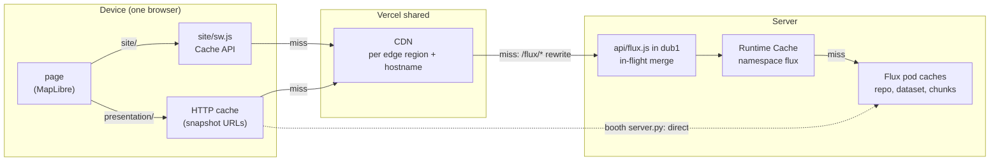

# Caching

How a tile or API response is cached between the Flux tiles service and the screen showing it,
for the three deployments in the [README](../README.md#deployments). There are three layers:

1. **Device**: the viewer's browser (service worker or HTTP cache). Private to one browser.
2. **Vercel shared**: Vercel's CDN. Shared by every viewer of one hostname in one edge region.
3. **Server**: the proxy function's Runtime Cache in `dub1`, and the per-pod caches inside the
   Flux tiles service. Shared by every viewer of every hostname.

A request stops at the first layer that has the answer. Only the hosted deployments (mobile
site and hosted presentation) have the Vercel layers; the booth machine goes straight to Flux.

## Request flow



Each arrow is taken only on a miss in the box it leaves. Locally (`http:` origin) the mobile
site also skips Vercel and fetches from Flux directly (`BASE` in `site/index.html`).

## What makes tiles cacheable at all

The pipeline commits each init once, with all its leads (see
[`build_runs`](../presentation/booth.py) and the [site README](../site/README.md#tile-cache)).
Once an init is listed, a tile URL (ref, init `time`, `lead_time`, variable, z/y/x) always
returns the same image. The query string is part of every cache key, so a client that orders
parameters differently gets its own entries.

Flux itself does not say so: branch tile URLs come back with `Cache-Control: public, max-age=0`,
snapshot id URLs with `public, max-age=2628000` (one month); the service has
`cache_max_age: 0` and no CLI option to change it
([TILE_SERVER_PERFORMANCE.md](TILE_SERVER_PERFORMANCE.md#caching-branch-vs-snapshot-urls)).
Each layer below works around that differently.

## Layer 1: device

| deployment | mechanism | tile URL ref | kept |
|---|---|---|---|
| mobile site (`site/`) | service worker `site/sw.js`, cache `tiles-v1`, cache first | `main` | newest 12 inits (`KEEP_INITS`), pruned every 50 stores |
| hosted presentation | browser HTTP cache | snapshot id (`run.ref`) | one month (Flux `max-age`) |
| booth (`server.py`) | browser HTTP cache | snapshot id (`run.ref`) | one month (Flux `max-age`) |

- **Mobile site.** `sw.js` intercepts `GET` requests to `/tiles/WebMercatorQuad/` that carry
  `time`, answers from the Cache API and goes to the network only on a miss. It stores only
  `res.ok` responses, so a `504` from a busy service, a `422` or a cold start never sticks.
  The Cache API has no eviction of its own, hence the pruning by init. On activation it
  deletes every cache whose name is not the current `CACHE`. Service workers need `https:` or
  `localhost`; on `file://` the page runs without this layer.
- **Presentation.** `tileTemplate` in `presentation/web/app.js` puts the run's snapshot id in
  the path instead of `main`, so Flux sends the one month `max-age` and the browser does not
  ask again. With branch URLs every repeat tile was a `304` round trip. Measured in headless
  Chrome on a reload: 44 to 74 tiles from the browser cache with snapshot URLs, 0 with branch
  URLs; the first load is unchanged
  ([TILE_SERVER_PERFORMANCE.md](TILE_SERVER_PERFORMANCE.md#caching-branch-vs-snapshot-urls)).
- **Not cached on the device.** `/api/state` and `/api/sql` polls use `cache: "no-store"`;
  the site's `_meta` init list too. `server.py` sends `Cache-Control: no-cache` on static files
  (so a reload picks up edits to `app.js` / `app.css`) and `no-store` on its `/api/*` answers
  (`send_json` default in `booth.py`).

## Layer 2: Vercel shared (CDN)

Vercel's CDN caches per edge region and per hostname: the `.earthmover.io` and `.vercel.app`
names of one project do not share entries. A redeploy empties it. It does not merge
simultaneous misses.

| path | deployment | CDN header set by | CDN TTL |
|---|---|---|---|
| `/flux/<repo>/<ref>/tiles/...` | both | `api/flux.js`: `Vercel-CDN-Cache-Control: max-age=86400` | 1 day |
| `/flux/_meta/datasets/<repo>/main/tree` | mobile site | `site/api/flux.js`: `max-age=30` | 30 s |
| `/api/config` | presentation | `api/config.py`: `s-maxage=300` | 5 min |
| `/api/state` | presentation | `api/state.py`: `s-maxage=5, stale-while-revalidate=60` | 5 s, stale up to 60 s |
| `/api/sql?place=&init=` | presentation | `api/sql.py`: `s-maxage=86400` | 1 day |

- The proxy sends browsers `Cache-Control: public, max-age=0` and keeps the long TTL for the
  CDN only (`Vercel-CDN-Cache-Control`), plus `Vercel-Cache-Tag: tiles,init-<YYYYMMDDHHMM>`
  (or `meta`). Errors are sent without the CDN headers, so they are not cached.
- `/api/state` reads commits on every uncached request (about 1.5 s warm, 8 s cold, per the
  [presentation README](../presentation/README.md#hosted-on-vercel)); 5 s of CDN cache with
  stale-while-revalidate keeps viewers polling every 4 s from waiting on it.
- `/api/sql` only runs the `config.json` query for a listed city and an init on the 10 min
  grid, so each city costs at most one SQL run per forecast run. `app.js` reads
  `x-vercel-cache` (`HIT` or `STALE`) to show "cached" in the panel.

## Layer 3: server

### Vercel function and Runtime Cache

`/flux/*` is rewritten to `api/flux.js` (`vercel.json`). The function is pinned to `dub1`,
next to Flux in eu-west-1, so its Runtime Cache (`getCache({ namespace: "flux" })`) is one copy
shared by every edge region and hostname. On a CDN miss it:

1. looks the key (path + query) up in the Runtime Cache: TTL 1 day for tiles, 30 s for `_meta`;
2. otherwise joins an in-flight request for the same key on the same instance, or starts one;
3. stores the Flux response only if it is `ok`, with the same tags as the CDN.

`x-flux-proxy-cache` on the response says which happened: `hit`, `joined` or `miss`.
`presentation/api/flux.js` is a copy that allows snapshot ids as ref and has no `_meta` path.

The in-flight merge covers one function instance only. 10 clients opening a new run together
made 1,007 Flux requests for 234 tiles (CDN alone: 1,427), measured 2026-10-15
([site README](../site/README.md#tile-cache)). That is why the warmers below exist.

### Flux tiles pods

Flux keeps no cache of rendered tiles, but each pod caches the inputs. From Earthmover's
traces on the eu-west-1 pods
([TILE_SERVER_PERFORMANCE.md](TILE_SERVER_PERFORMANCE.md#server-side-caches-and-http2-2026-10-15)):

| step | cold | kept |
|---|---|---|
| open repo | ~335 ms | 1 hour, max 2 repos per pod |
| open a dataset version | ~440 ms | until pushed out by newer ones (32 per pod) or the hourly reset |
| check a branch for new commits | ~60 ms | rechecked every 60 s |
| read a chunk | ~20 ms (vs ~2.5 ms from memory) | memory sized to the pod, cleared hourly |

Each pod caches on its own; new pods, scale-ups and scale-from-zero start cold. Responses
carry `cache-status` (`flux-repo`, `flux-credentials`, `flux-ref`, `flux-dataset`,
`flux-tiles_grid`, each `hit`, `fwd=miss` or `fwd=bypass`) and `x-flux-inbound-bytes`;
`X-Flux-Cache-Bypass: all` skips most of them.

Measured 2026-10-15, one full run (260 tiles, 6 in flight, HTTP/2) on 8 pinned replicas:
18.6 to 19.7 s with the pod caches, 96.4 to 98.7 s with `X-Flux-Cache-Bypass: all`; storage
read per tile 2.3 to 2.4 MB against 11.2 to 11.3 MB (same doc). This is why the service runs
with `min = max = 8` replicas during booth hours, and why the booth page is loaded once before
doors open ([presentation README](../presentation/README.md#before-the-event)).

### Booth server SQL

`server.py` keeps SQL results in memory per (init, query text) and drops them when a new init
lands. Pressing Run again before then shows the stored result marked `cached` without
querying the SQL service (`poll_sql` in `presentation/server.py`). Tiles are not proxied by
`server.py`; the booth browser fetches them from Flux.

## Cache warming

The CDN does not merge misses and the in-flight merge is per instance, so viewers who open a
new run together still make Flux render each tile several times. Two scripts request each new
run's tiles once through the proxy as soon as it is listed, so viewers get hits:

| script | deployment | detects new runs from | requests |
|---|---|---|---|
| `scripts/warm_tiles.py` | mobile site | Flux `_meta` tree, polled directly (the proxy keeps it 30 s) | default view z2 to z4, both variables, every lead |
| `scripts/warm_presentation_tiles.py` | hosted presentation | `/api/state` | z4 home view plus composite previews, both variables, every lead: 754 tiles, ~20 s |

```bash
uv run --no-project python scripts/warm_tiles.py https://<site hostname>
uv run --no-project python scripts/warm_presentation_tiles.py https://<presentation hostname>
```

Both only help if their requests hit the same cache keys as viewers:

- **Same hostname.** The CDN is keyed by it; warming `.vercel.app` does nothing for
  `.earthmover.io` viewers at the CDN (the Runtime Cache is still shared).
- **Same URL, byte for byte.** `warm_tiles.py` mirrors `tileUrl` in `site/index.html`,
  `warm_presentation_tiles.py` mirrors `tileTemplate` in `presentation/web/app.js` (parameter
  order, snapshot id as ref). Change one without the other and the warmer fills keys nobody
  reads.

Measured:

- Mobile site, 2026-10-15, test deployment, 10 clients starting 30 s after a new init became
  visible: 95 of 2,340 requests missed with the warmer, 1,597 without; a full run took each
  client 27 s instead of 66 s ([site README](../site/README.md#tile-cache)).
- Hosted presentation, 2026-10-15, test deployment: after the warmer ran, a browser opening
  the page got 227/227 tiles as `x-vercel-cache: HIT`. Zooming or panning past the home view
  still misses ([presentation README](../presentation/README.md#hosted-on-vercel)).

Zooming past the warmed views, and the booth machine (no Vercel), still go to the Flux pods.
